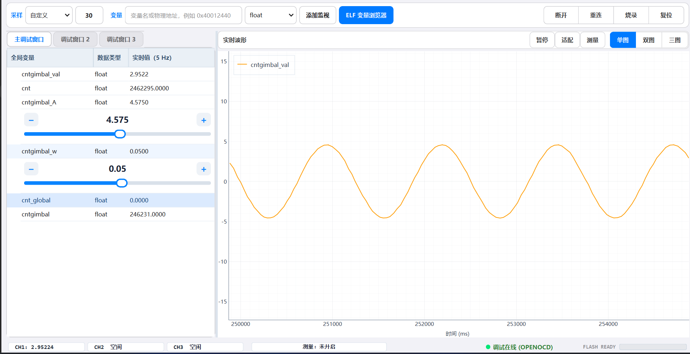
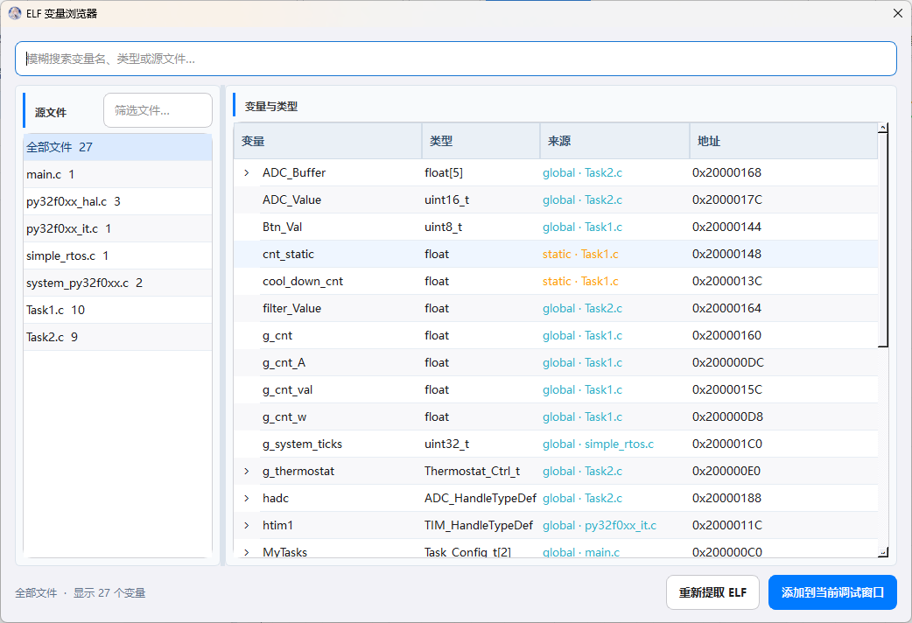
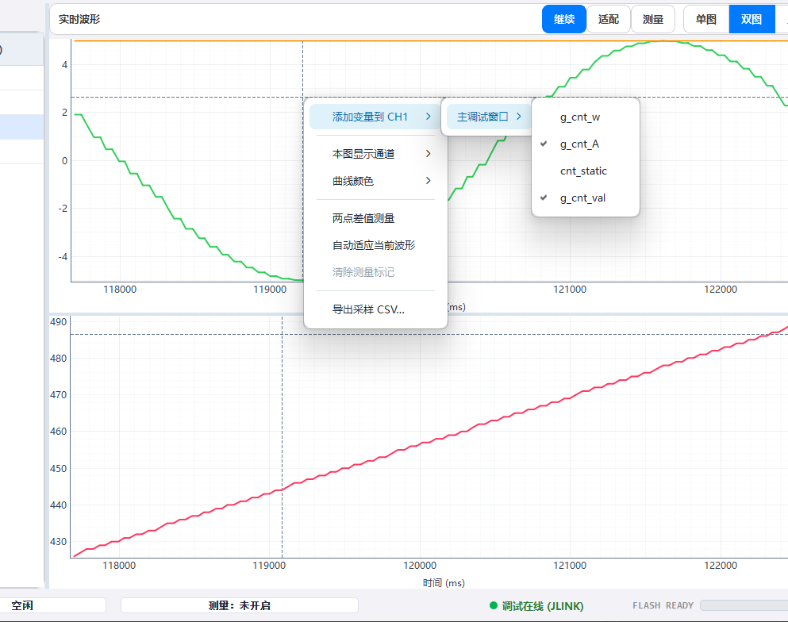
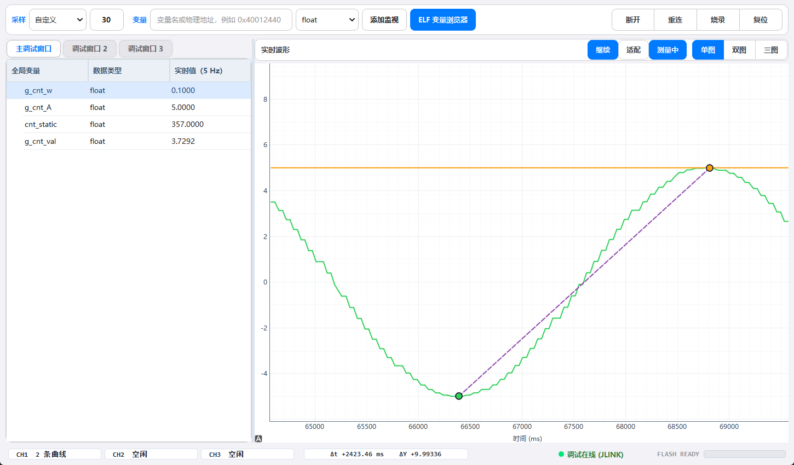
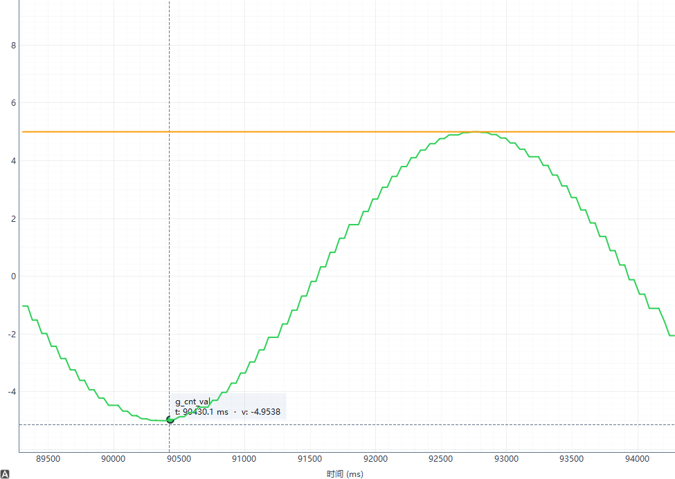

# MCU Live Watch Studio V2.1

一个轻量的 Cortex-M 实时变量监视、波形分析与固件烧录工具。

它直接通过 ELF/DWARF 找到变量，再使用 SEGGER J-Link DLL 或 OpenOCD 读写 MCU 内存。固件不需要增加串口协议，也不需要为了观察变量而暂停正在运行的控制系统。适合电机控制、数字电源、传感器、PID 调参和现场状态分析。



## V2.1 频谱分析版

V2.1 在实时变量示波器和在线调参基础上加入独立 FFT 频域分析，并完善工具链发现与安全返回配置流程：在同一个工作区中完成 ELF 变量浏览、多个变量滑动调节、时域/频域分析、CSV 导出、固件烧录和断线重连。

- 多个变量可以同时展开整宽滑动条，范围、步进和写入方式互相独立。
- 支持拖动、点击滑轨、键盘方向键以及减号/加号长按连续调节，走到边界自动扩展范围。
- 每个波形视图可独立切换 FFT，显示基波、谐波百分比、THD、线性幅值或 dBc，并支持暂停后吸附频谱点。
- J-Link 原生与 OpenOCD 双后端；点击“扫描电脑”后查找本机固定磁盘，结果保存在可编辑下拉框中，启动时不会自动扫描。
- 工作站可以安全返回配置，返回和关闭只释放采样与调试连接，不主动发送复位、暂停或烧录命令。
- 高频波形继续保存在内存，长期历史由后台线程批量写入 SQLite；CSV 自动合并数据库与内存尾部。
- 低速读取、高速采样、变量写入、烧录、重连、ELF 解析和历史保存均不阻塞主界面。
- 全项目回归覆盖 500 组用户与组件组合，并对最终 EXE 执行 PyQt6 和主界面启动自检。

### 下载版使用

发布附件见 [MCU Live Watch Studio V2.1 · 频谱分析版](https://github.com/1772631792/McuStdio/releases/tag/v2.1.0)。

1. 只使用 SEGGER J-Link：下载 `Mcu_Studio.exe`，电脑安装 SEGGER J-Link Software 后直接运行。
2. 使用 ST-Link、CMSIS-DAP/DAPLink 或 OpenOCD：同时下载 `OpenOCD.zip`，放在 EXE 同级并直接解压，得到 `OpenOCD/` 目录。
3. 首次运行会在 EXE 同级创建 `live_watch_history.db`，保存配置、调节参数和受控容量的采样历史。

完整变更见 [V2.1 发布说明](RELEASE_NOTES_V2.1.md)。

## 设计目标

- **保持 MCU 运行**：普通监视和波形采样不依赖断点，避免停机影响实时系统。
- **变量优先**：搜索、结构展开、实时值和波形绑定都围绕变量组织，减少无关界面。
- **配置轻量**：工作状态集中保存在一个 SQLite 文件中，复制 DB 即可切换项目配置。
- **后端解耦**：J-Link 原生和 OpenOCD 共用相同的 ELF、变量、波形与烧录流程。
- **适合嵌入现有流程**：可以继续使用 VS Code、Make/CMake 或厂商工程编译，只把本软件作为实时观察窗口。

### 开源定位与协作关系

MCU Live Watch Studio 是对传统嵌入式工具配置复杂、实时观测不直观和工作流封闭等问题的一次开源尝试：用开放、轻量的方式，提供更直接的变量观测、在线调参与频域分析体验。

它不以替代 Keil、Ozone、EmberProbe 或其他调试工具为目标。商业软件适合完整工程管理与深度源码调试，EmberProbe 等开源项目提供各有侧重的一体化工作流，本软件则专注独立变量示波器、在线调参和频域分析。它们可以按需要同时使用，也可以互相补充。

## 为什么适合作为独立变量示波器

MCU Live Watch Studio 不要求替换现有编译环境。工程仍可使用 Keil、Ozone、VS Code、Make/CMake 或厂商 IDE 编译，本软件只读取生成的 ELF，并作为一个可以独立运行的变量示波器和在线调参面板。

- **打开即观察**：不必先建立完整的源码调试会话，选择 ELF 和调试后端后即可添加变量、观察波形。
- **运行中采样**：普通变量监视和波形采样不依赖断点，适合不能频繁暂停的电机、数字电源、闭环控制和传感器系统。
- **调参与波形在同一界面**：多个变量可同时展开滑动条，修改参数后立即观察曲线变化，减少在监视窗口、表达式窗口和绘图工具之间切换。
- **可以脱离开发工程长期运行**：EXE 可单独放在测试电脑上使用；只要提供匹配的 ELF、探针和目标配置，就能作为现场监视工具。
- **历史不只属于当前会话**：采样记录由后台线程持续写入 SQLite，重新打开软件后仍可用于 CSV 导出；内存中的高速数据和磁盘中的长期历史会自动衔接。
- **J-Link 与 OpenOCD 双后端**：既能使用 SEGGER 官方 J-Link DLL，也能通过 OpenOCD 使用 ST-Link、CMSIS-DAP/DAPLink 等探针，不绑定单一 IDE 或单一调试器品牌。
- **配置便于迁移**：变量、波形通道、滑动条参数、颜色和界面布局集中保存在数据库中，复制数据库即可带走整套观测配置。
- **界面职责更集中**：主界面围绕变量、波形、测量、CSV 和在线写值设计，适合把它放在第二块屏幕上持续观察。

### 与 Keil、Ozone 的互补使用

Keil 和 Ozone 是完整的源码级调试工具，适合断点、单步、调用栈、寄存器和故障定位；MCU Live Watch Studio 的优势则是把日常实时观察与在线调参做得更独立、更直接：

- 不需要改变原有编译和代码编辑习惯，可作为 Keil/Ozone 之外的常驻变量示波器。
- 同一套界面同时支持实时表格、多图波形、两点测量、多变量滑动调参和 CSV 导出。
- 可以用 J-Link 原生模式追求 Windows 下的兼容性和速度，也可以切换 OpenOCD 覆盖更多常见探针。
- 采样、变量写入、烧录、重连、ELF 解析和历史保存均放在后台线程，长时间观察时主界面保持响应。
- 三个逻辑调试窗口可以独立保存、拖出悬浮，适合将控制参数、状态量和故障量分区显示。

它不用于取代 Keil/Ozone 的断点和源码级调试。推荐的组合方式是：使用原有 IDE 编译和处理复杂故障，使用 MCU Live Watch Studio 做运行中的连续波形观察、参数整定、数据留存和现场复测。

## 主要能力

### ELF 变量浏览器



- 从 ELF 符号表和 DWARF 读取全局变量、文件内 `static` 变量、结构体、数组和枚举。
- 左侧按源文件筛选，文件搜索和顶部变量搜索均支持模糊匹配；留空时不筛选。
- “全部文件”视图优先排列最近使用的变量。
- 结构体和数组可直接懒加载展开，大型 ELF 单次最多渲染 2000 个搜索结果。
- 双击或点击添加后浏览器保持打开，可以连续加入多个变量。
- 右键可以明确添加到主调试窗口、调试窗口 2 或调试窗口 3。

调试窗口保存的是变量路径。ELF 被重新编译或烧录后，软件会重新解析地址、类型和结构成员偏移；只要变量名没有改变，就会自动跟随新的链接地址。已经改名或删除的变量不会继续读取旧地址。

### 实时波形

- CH1、CH2、CH3 是三个显示分组，每个 CH 都可以绑定多个变量。
- 同一个变量出现在多个窗口或多个 CH 时，底层只采样一次，再分发到不同视图。
- 支持单图、双图、三图布局以及自定义采样频率。
- 每个波形视图可通过右键独立切换为频域分析（FFT），时域与频域设置分别保存。
- 曲线自动分配高辨识度颜色，也可以通过右键单独修改并持久化。
- 每个波形提供紧凑图例，变量名、颜色和曲线直接对应；适配时自动移动到曲线最少的角落。
- 绘图使用峰值保留降采样，保留突变特征，同时限制长期运行时的绘制点数。



波形区域右键可以完成常用操作：添加变量、控制本图通道、修改曲线颜色、自动适配、开启测量以及导出采样 CSV。界面不会显示 pyqtgraph 的内部菜单。

### 频域分析与谐波

在任一波形区域右键，选择“显示模式 → 频域分析（FFT）”，该视图会从时域波形切换为独立频谱图；其他 CH 可以继续显示时域或使用不同的 FFT 参数。

- 默认以基波为 `100%` 显示单边幅值谱，并在整数倍频率处标记谐波。
- 图内摘要给出实际采样率、FFT 点数、频率分辨率、基波频率与幅值、各次谐波相对基波百分比以及 THD。
- 可选择 Hann、Flat Top、Hamming、Blackman 和矩形窗；Hann 适合一般频谱观察，Flat Top 优先保证幅值准确度。
- 可设置自动或固定 FFT 点数、去直流、显示最高频率、基波搜索上下限、谐波次数以及谐波峰值搜索宽度。
- 纵轴支持相对基波百分比、线性幅值和 dBc。基波搜索范围可避免把强谐波误识别为基波。
- 实际采样时间有轻微抖动时，会先根据时间戳重采样为等间隔序列；幅值按窗函数相干增益校正。
- 暂停波形后仍可对当前缓存切换时域/频域并调整 FFT 参数，继续采样后频谱自动刷新。
- 频域暂停后移动鼠标可吸附最近的频谱点；基波和谐波点会显示 H1/H2…、频率、相对基波百分比及线性幅值。

FFT 适合分析近似稳态信号。采样率必须高于待观察最高频率的两倍，并应保留足够长的采样时间；频率过高、采样点过少或基波搜索范围不正确都会影响谐波结果。

### 两点测量与冻结回看



点击“测量”后波形自动冻结。选择两个采样点即可得到横轴时间差 `Δt` 和纵轴差值 `ΔY`，结果固定显示在底部状态栏，不遮挡曲线。



冻结状态下，十字线平滑跟随鼠标，数据圆点和标签吸附最近的真实采样点。“适配”只调整一次纵轴，滚轮修改后的观察范围也会保持，不会反复改变正弦波等周期信号的显示比例。空格键全局只负责暂停或继续波形，不会触发当前获得焦点的其他按钮。

### 三个调试窗口

- 固定提供三个逻辑调试窗口，每个窗口独立保存变量。
- 表格以约 5 Hz 刷新可见标量，结构体和数组支持展开。
- 双击标量值可以写回 MCU；写入前应确认类型和设备安全状态。
- 双击标签或拖动标签可把完整调试窗口悬浮出来，关闭悬浮窗口后自动恢复原位置。

### 调试窗口滑动调节

- 在调试窗口中右键数值标量并选择“打开滑动调节”，该变量紧接着的下一行会显示横跨整个表格宽度的滑动条。
- 调节行提供当前值、宽滑条和减号/加号按钮；它不占用狭窄的实时值单元格，右键变量可以设置参数或恢复普通数值模式。
- 支持同时展开多个变量的滑动条；每个变量的范围、步进、自动扩展和写入方式独立保存，单独关闭互不影响。
- 默认在松开滑块后才写入，设备回读不会覆盖正在进行的手势；可按需开启拖动实时写入，实时模式按 100 ms 合并且只保留最新待写值。
- 点击滑轨或聚焦后使用左右方向键可按步进调节；减号/加号按钮与方向键都支持长按连续调节，走到当前显示边界时会自动扩展范围。
- 每个调试窗口的滑条状态与范围分别保存在 `live_watch_history.db`。枚举和指针不提供滑条，仍可在变量表中编辑。

### 工作区自动恢复

程序同级的 `live_watch_history.db` 会保存：

- ELF、调试后端、探针和 cfg 配置；
- 三个调试窗口中的变量；
- 每个 CH 绑定的变量与曲线颜色；
- 单图/双图/三图模式、左右和上下分割比例；
- 采样频率、当前调试页和窗口尺寸；
- ELF 浏览器的最近使用权重。
- 波形采样历史：内存保持原始高速数据，SQLite 后台保存每个变量最高约 200 Hz 的长期历史，总量自动限制在约 100 万行。

再次打开软件时会先使用当前 ELF 校验变量，再恢复波形和布局，不需要重复添加变量。CSV 导出会合并数据库历史和当前内存中的最新数据。

## 调试后端

| 后端 | 可用探针 | 说明 |
| --- | --- | --- |
| J-Link 原生 | SEGGER J-Link | 使用 SEGGER 官方 DLL，Windows 下速度和兼容性优先 |
| OpenOCD | ST-Link | 使用对应 interface 与 target cfg |
| OpenOCD | DAPLink / CMSIS-DAP | 使用 CMSIS-DAP interface cfg |
| OpenOCD | J-Link adapter | 依赖 libusb，通常不应与 SEGGER 官方驱动混用 |

两种后端都支持变量读写、实时波形、后台 ELF 烧录、校验、复位和连接恢复。OpenOCD 模式还支持自选厂商 interface/target cfg；程序会自动加入 cfg 所在目录作为脚本搜索路径。

启动页的 J-Link 和 OpenOCD 路径使用可编辑下拉框。打开配置页时只加载数据库选择、历史扫描结果和随程序 OpenOCD，不会自动扫描磁盘。点击对应的“扫描电脑”后，程序才会检查系统 PATH、注册表和常见安装目录，并由后台线程扫描本机所有固定磁盘；找到的 `openocd.exe` 和匹配当前程序位数的 J-Link DLL 会持续加入下拉列表。扫描不会阻塞界面，网络磁盘、系统目录、回收站和源码依赖目录不会遍历。

工作站顶部的断开操作区旁提供“返回配置”图标按钮。返回或关闭程序时会停止采样与变量写入、等待后台线程结束、关闭 TCL socket、终止本软件启动的 OpenOCD 并释放 J-Link 句柄；该流程不会主动发送 `reset`、`halt`、`program` 或烧录命令。烧录或重连尚未完成时会暂时禁止返回，避免中断正在进行的操作。

> 返回配置和关闭程序不会主动复位 MCU；但从配置页重新连接 OpenOCD 时，target cfg 的初始化事件是否复位目标取决于对应脚本和探针。不能复位的设备应先进入安全状态再重新连接。

> J-Link 原生模式与 OpenOCD 的 J-Link adapter 是两套驱动链路。Windows 出现 `LIBUSB_ERROR_NOT_SUPPORTED` 时，优先使用 J-Link 原生模式，不要随意替换 SEGGER 官方 USB 驱动。

## 快速开始

### 从源码运行

需要 Python 3.10 或更高版本：

```powershell
python -m pip install PyQt6 pyqtgraph numpy pyelftools pylink-square
python .\main.py
```

也可以直接运行打包后的 `Mcu_Studio.exe`。首次启动时会在程序同级创建 `live_watch_history.db`。

### 连接和使用

1. 选择包含调试信息的 `.elf` 文件，固件编译时建议保留 `-g`。
2. 选择 J-Link 原生或 OpenOCD 后端并填写对应配置。
3. 进入工作站，通过顶部输入框或 ELF 变量浏览器添加变量。
4. 在调试变量上右键，将标量绑定到 CH1、CH2 或 CH3。
5. 使用暂停、适配和测量完成动态观察；需要保存数据时在波形或变量上右键导出 CSV。

仓库自带 OpenOCD，默认位置为：

```text
runtime/OpenOCD/bin/openocd.exe
```

OpenOCD 连接、重连和烧录可能复位目标，具体行为取决于 target cfg。电机、功率设备和其他不能随意复位的系统，应先断开执行机构并在安全环境验证。

## 性能与稳定性

- J-Link 会合并连续地址读取，且不会跨越地址空洞。
- OpenOCD 使用统一 TCL 请求完成一轮高速采样，连续安全区间使用块读取。
- 低速表格、高速采样、烧录和后端重连都在后台线程执行。
- 变量滑条和表格编辑共用一个串行写入线程；J-Link 读写共享锁，OpenOCD 写入使用独立 TCL 连接，不阻塞 Qt 界面。
- 采样历史由独立线程批量写入 SQLite WAL，8 kHz 波形显示不会逐点同步写数据库。
- 每个高速变量的历史缓存有上限；绘图最多使用约 4000 个峰值保留点。
- 关闭窗口时会等待后台通信线程安全结束，避免 `QThread: Destroyed while thread is still running`。
- ELF 文件变化会等待写入稳定后在后台线程重新提取，解析期间界面保持响应，失败时保留原有有效数据。

## 校验与打包

不连接探针、不读写 MCU 的全项目校验：

```powershell
python .\tools\validate_project.py
```

校验包含 432 个用户工作流组合及 68 个数值、写队列和工具发现组合。详细维度见 [回归测试矩阵](doc/09-回归测试矩阵.md)。

构建 Windows EXE：

```powershell
python -m pip install pyinstaller
python .\build.py
```

打包配置会排除未使用的 Qt PDF、测试、OpenGL、翻译和冷门图片插件。当前构建环境中单文件 EXE 由约 58.0 MB 降至约 51.8 MB；NumPy/OpenBLAS 与 Qt 核心图形库仍是主要体积来源，为保证波形和兼容性予以保留。

成品输出到 `dist/Mcu_Studio.exe`。`build.py` 强制使用 PyQt6，并检查产物中是否混入第二套 Qt。

## 项目结构

```text
McuStdio/
├─ main.py                  # 应用入口
├─ build.py                 # PyInstaller 构建入口
├─ mcu_studio/             # UI、ELF/数据库核心和后台任务
├─ assets/                 # 应用图标与 README 截图
├─ runtime/OpenOCD/         # 内置 OpenOCD 与 cfg
├─ tools/                  # 无硬件校验工具
├─ doc/                    # 完整使用与维护文档
└─ live_watch_history.db   # 本机工作状态（首次运行后生成）
```

更详细的连接、变量、烧录、数据库迁移、构建和故障排查说明见 [文档目录](doc/README.md)。第三方组件保留各自许可证。
