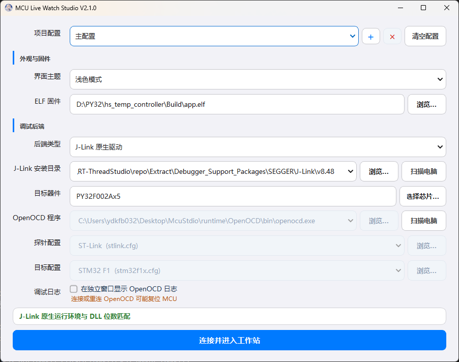

# MCU Live Watch Studio V2.4

用于 Cortex-M 的实时变量监视、在线调参、波形分析和固件烧录工具。

软件读取 ELF/AXF 中的符号和 DWARF 调试信息，通过 SEGGER J-Link DLL 或 OpenOCD 读写 MCU 内存。固件不需要增加串口协议，普通变量监视也不依赖断点。适用于电机控制、数字电源、PID 调参、传感器和现场测试。


| 需求 | 对应功能 |
| --- | --- |
| 查看运行中的变量 | ELF/AXF 变量浏览器、三个调试窗口、结构体和数组展开 |
| 在线调整参数 | 多变量滑动条、直接写值、步进与范围保存 |
| 查看动态变化 | CH1～CH3 多变量波形、暂停、缩放、光标和两点测量 |
| 分析频率和谐波 | 独立 FFT 视图、基波、谐波、THD、线性幅值和 dBc |
| 保存测试结果 | SQLite 历史、CSV 导出、多套项目配置 |
| 使用不同探针 | J-Link 原生、ST-Link、CMSIS-DAP/DAPLink、OpenOCD |
| 烧录和切换固件 | ELF/AXF 烧录、校验、复位、烧录后地址同步 |

## 目录

- [V2.4 重点更新](#v24-重点更新)
- [下载与版本选择](#下载与版本选择)
- [五分钟开始使用](#五分钟开始使用)
- [功能说明](#功能说明)
- [调试后端与探针](#调试后端与探针)
- [数据保存与多项目配置](#数据保存与多项目配置)
- [连接、烧录与退出安全](#连接烧录与退出安全)
- [源码运行、校验与打包](#源码运行校验与打包)

## V2.4 重点更新

- 配置页只保存和校验设置，不打开 J-Link，也不启动 OpenOCD；进入工作站后才在后台连接探针。
- 检测到探针被下载器或其他调试软件占用时自动停止读写并断开，关闭外部程序后由用户手动重连。
- 手动重连成功后重新读取磁盘上最新的 ELF/AXF 一次，再恢复变量采样。
- 标题栏 X 具有最高退出优先级：停止软件任务、关闭套接字和本软件启动的 OpenOCD 后直接退出，不等待可能卡住的 J-Link DLL。
- 大变量列表只读取当前可见的标量和已展开结构体中的可见成员；每轮最多处理 32 个叶子变量并轮询其余项目。
- 顶层变量可以在三个调试窗口之间拖动；结构体成员可拖成独立顶层变量，便于单独观察和打开滑动调节。
- ELF 和 Keil AXF 均可作为固件与调试信息来源。
- 便携包自带 OpenOCD，并加入一键创建桌面快捷方式的脚本。

完整版本变化见 [V2.4 发布说明](doc/releases/RELEASE_NOTES_V2.4.md)和[更新记录](doc/releases/CHANGELOG.md)。

## 下载与版本选择

[MCU Live Watch Studio V2.4 Release](https://github.com/1772631792/McuStdio/releases/tag/v2.4.0) 提供三个附件：

| 附件 | 适合谁 | 是否包含 OpenOCD | 使用方式 |
| --- | --- | --- | --- |
| [Mcu_Studio.exe](https://github.com/1772631792/McuStdio/releases/download/v2.4.0/Mcu_Studio.exe) | 已安装 SEGGER J-Link Software，或希望自行配置 OpenOCD 的用户 | 否 | 下载后直接运行 |
| [Mcu_Studio_Portable_v2.4.zip](https://github.com/1772631792/McuStdio/releases/download/v2.4.0/Mcu_Studio_Portable_v2.4.zip) | 希望解压即用，或使用 ST-Link、CMSIS-DAP/DAPLink 的用户 | 是 | 完整解压后运行目录中的 EXE |
| [OpenOCD.zip](https://github.com/1772631792/McuStdio/releases/download/v2.4.0/OpenOCD.zip) | 给单文件版补充 OpenOCD 运行环境 | 仅 OpenOCD | 放到单文件版旁边解压 |

### 便携版怎么用

1. 下载 `Mcu_Studio_Portable_v2.4.zip`。
2. 完整解压到一个可写目录，不要只从压缩包中单独拖出 EXE。
3. 运行 `Mcu_Studio/Mcu_Studio.exe`。
4. 如需桌面图标，双击同目录的 `Create_Desktop_Shortcut.cmd`，它会创建名为 `Mcu_Studio` 的快捷方式。

便携版已经包含：

```text
Mcu_Studio/
├─ Mcu_Studio.exe
├─ Create_Desktop_Shortcut.cmd
├─ portable-mode.flag
├─ data/                         # 数据库和本地配置
└─ runtime/OpenOCD/              # 完整 OpenOCD 运行环境与 cfg
```

快捷方式只指向解压目录中的程序，不会复制或移动 EXE。以后移动整个便携目录后，需要重新运行脚本生成快捷方式。

### 单文件版怎么用

1. 下载 `Mcu_Studio.exe`，放到一个可写目录后运行。
2. 使用 **J-Link 原生模式**时，电脑需要安装与程序位数匹配的 SEGGER J-Link Software；在启动页选择 J-Link 安装目录或点击“扫描电脑”。
3. 使用 **OpenOCD 模式**时，可以下载独立的 `OpenOCD.zip`，放到 `Mcu_Studio.exe` 同级并解压，形成下面的结构：

```text
工作目录/
├─ Mcu_Studio.exe
└─ OpenOCD/
   ├─ bin/openocd.exe
   └─ share/openocd/scripts/
```

软件会自动识别同级的 `OpenOCD/bin/openocd.exe`；也可以在启动页手动浏览到其他 OpenOCD。

### 三个附件之间的关系

- 只使用 SEGGER J-Link：下载 `Mcu_Studio.exe` 即可，但电脑需要安装 SEGGER 官方驱动和 DLL。
- 使用 ST-Link 或 CMSIS-DAP：优先下载便携版，它已经带好 OpenOCD。
- 已经下载单文件版但之后需要 OpenOCD：再下载 `OpenOCD.zip` 并解压到 EXE 旁边。
- 便携版已经包含 OpenOCD，不需要再下载 `OpenOCD.zip`。

## 五分钟开始使用

### 1. 准备固件

选择与 MCU 当前固件匹配的 `.elf` 或 `.axf` 文件。固件编译时必须保留调试信息，例如 GCC 工程使用 `-g`；如果文件被完全剥离，软件只能看到有限符号，无法正确解析结构体与类型。

### 2. 选择调试后端

- SEGGER J-Link 探针优先选择“J-Link 原生驱动”。
- ST-Link、CMSIS-DAP/DAPLink 或需要自定义 cfg 时选择“OpenOCD”。
- 配置页不会立即占用探针，点击“连接并进入工作站”后才开始后台连接。

### 3. 添加变量

进入工作站后，可以使用顶部输入框添加变量，也可以打开 ELF 变量浏览器：

- 按源文件筛选全局变量和文件内 `static` 变量。
- 搜索变量、结构体、数组和枚举。
- 右键选择添加到主调试窗口、调试窗口 2 或调试窗口 3。

### 4. 观察波形和在线调参

- 在变量上右键，将标量绑定到 CH1、CH2 或 CH3。
- 每个 CH 可以同时显示多条变量曲线。
- 在数值变量上右键打开滑动调节，修改参数后立即观察波形变化。
- 使用暂停、适配、两点测量或 FFT 分析当前数据。

### 5. 保存数据

在波形或变量菜单中导出 CSV。导出会合并 SQLite 中的历史数据和当前内存中尚未落盘的最新高速数据。

## 功能说明

### ELF/AXF 变量浏览器


- 解析 ELF/AXF 符号表和 DWARF，支持全局变量、文件内 `static`、结构体、数组和枚举。
- 源文件筛选和变量搜索都支持模糊匹配；“全部文件”优先显示最近使用的变量。
- 结构体与数组按需展开，大型固件单次最多渲染 2000 个结果，避免一次创建过多界面项。
- 添加变量后浏览器保持打开，可以连续加入多个变量。
- 支持按变量名或物理地址添加监视项。
- 磁盘上的 ELF/AXF 变化后先标记为“待烧录”，不会在 MCU 仍运行旧固件时提前替换地址映射。
- 烧录成功后按变量名同步新地址、类型和成员偏移；已经不存在的变量会从监视、滑条和波形绑定中移除。

### 三个可拆分调试窗口

- 固定提供三个逻辑调试窗口，分别保存变量和界面状态。
- 调试页可以拖出成为悬浮窗口，关闭悬浮窗口后按原顺序回到主界面。
- 顶层变量可以在主窗口和悬浮窗口之间拖放。
- 结构体成员可以拖到其他调试窗口，成为独立顶层调试项，同时保留原结构中的成员显示。
- 双击普通数值可直接写回 MCU；右键可绑定波形、导出数据或打开滑动调节。
- 大量变量只按当前可见区域刷新；折叠结构体后不读取隐藏成员，展开后再按轮询批次读取。

### 多变量滑动调参

- 多个变量可以同时展开整行宽滑动条，每个变量的范围、步进和写入方式互相独立。
- 支持拖动滑块、点击滑轨、键盘左右方向键和减号/加号按钮。
- 方向键与减号/加号支持长按连续调节，到达当前边界时自动扩展范围。
- 默认在松开滑块后写入；也可以启用拖动实时写入。
- 实时写入按约 100 ms 合并同一变量的请求，只保留最新待写值，避免拖动时堆积大量旧命令。
- MCU 回读不会覆盖正在进行的滑动手势。
- 滑条设置按项目配置和调试窗口保存，重新打开后自动恢复。

### 多变量实时波形


- CH1、CH2、CH3 是三个显示分组，每个 CH 都可以绑定多条变量曲线。
- 同一变量出现在多个调试窗口或多个 CH 时，底层只采样一次，再分发到不同视图。
- 支持单图、双图和三图布局，以及 300、500、1000、2000、4000、8000 Hz 和自定义采样频率。
- 曲线自动分配高辨识度颜色，也可以逐条修改并保存。
- 每个视图带紧凑图例，自动适配时会把图例移动到曲线较少的角落。
- 长时间运行使用有上限的历史缓存和峰值保留降采样，限制绘图点数的同时保留尖峰。
- 适配只调整一次纵轴；用户滚轮缩放后的范围不会被后续数据反复重置。

### FFT、谐波和 THD

每个波形视图都能独立切换为频域分析，其他 CH 可以继续显示时域波形。

- 显示实际采样率、FFT 点数、频率分辨率、基波频率和幅值。
- 标记整数次谐波，显示各次谐波相对基波百分比和 THD。
- 纵轴支持相对基波百分比、线性幅值和 dBc。
- 支持 Hann、Flat Top、Hamming、Blackman 和矩形窗，并按窗函数相干增益校正幅值。
- 支持自动或固定 FFT 点数、去直流、最高显示频率、基波搜索范围、谐波次数和峰值搜索宽度。
- 采样时间存在轻微抖动时，会先按时间戳重采样为等间隔序列。
- 暂停后鼠标可吸附频谱点，显示 H1/H2 等标记、频率、相对百分比和线性幅值。

> FFT 适合近似稳态信号。采样率应高于目标最高频率的两倍，并保留足够长的采样时间。

### 冻结回看、光标和两点测量


- 空格键全局暂停或继续波形，不会误触当前获得焦点的按钮。
- 冻结后十字光标和数据标签吸附最近的真实采样点。
- 两点测量自动冻结波形，给出时间差 `Δt` 和数值差 `ΔY`。
- 测量结果固定在底部状态栏，不遮挡曲线。
- 暂停后仍可切换时域/频域、修改 FFT 参数和检查当前缓存。


### 历史记录与 CSV

- 高频原始波形保存在内存，用于当前视图和即时分析。
- 后台线程把每个变量最高约 200 Hz 的长期历史批量写入 SQLite，不会逐点阻塞界面。
- 历史总量自动限制在约 100 万行，避免数据库无限增长。
- CSV 导出会合并数据库历史和内存中的最新尾部，并按时间去重。
- 正常关闭数据库后会清理 SQLite WAL/SHM 边车文件，持久状态保持为一个主数据库。

### 工作区自动恢复

软件会保存并恢复：

- ELF/AXF 路径、调试后端、探针与 cfg；
- 三个调试窗口中的变量、结构体成员和滑动条参数；
- 每个 CH 的变量绑定、曲线颜色和时域/频域设置；
- 单图/双图/三图布局与分割比例；
- 采样频率、当前调试页、悬浮窗口和主窗口尺寸；
- ELF 浏览器最近使用排序与长期采样历史。

### 后台任务

低速变量读取、高速采样、变量写入、ELF/AXF 解析、烧录、重连、历史保存和调试工具扫描都在后台执行。J-Link 会合并连续地址读取，但不会跨越地址空洞。OpenOCD 高速采样会合并 TCL 请求，并在地址范围安全时使用块读取。

## 调试后端与探针

| 后端 | 支持的探针 | 特点 |
| --- | --- | --- |
| J-Link 原生 | SEGGER J-Link | 使用 SEGGER 官方 DLL，Windows 下兼容性和速度优先 |
| OpenOCD | ST-Link | 使用对应 adapter/interface 与 target cfg |
| OpenOCD | CMSIS-DAP / DAPLink | 使用 CMSIS-DAP adapter cfg |
| OpenOCD | J-Link adapter | 依赖 libusb，与 SEGGER 官方驱动不是同一链路 |

两种后端都支持变量读取、写值、波形、ELF/AXF 烧录、校验、复位和连接恢复。OpenOCD 可以选择内置配置，也可以浏览自定义 adapter/interface 和 target cfg；软件会自动把 cfg 所在目录加入脚本搜索路径。

### 调试工具发现

- 启动配置页只加载已保存路径和随程序提供的 OpenOCD，不会自动扫描整个磁盘。
- 点击“扫描电脑”后才检查 PATH、注册表、常见安装目录和本机固定磁盘。
- 扫描在后台进行，不遍历网络磁盘、回收站和明显的依赖/系统目录。
- 找到的 `openocd.exe` 和匹配当前程序位数的 J-Link DLL 会加入可编辑下拉框并保存。

> Windows 使用 SEGGER J-Link 时，优先选择 J-Link 原生模式。遇到 `LIBUSB_ERROR_NOT_SUPPORTED` 不要随意替换 SEGGER 官方 USB 驱动。

## 数据保存与多项目配置



一个 `live_watch_history.db` 可以保存多套互相隔离的项目配置，不需要为每个工程复制数据库：

- 固定的“主配置”始终存在且不能删除。
- 使用 `+` 创建新配置，使用 `×` 删除当前非主配置。
- 切换配置会恢复各自的 ELF/AXF、后端、监视变量、波形、滑动条、布局和历史。
- “清空配置”保留配置名称，但删除该配置保存的 UI 状态、后端设置、变量、波形绑定和历史采样。
- 清空后，旧历史不再参与 CSV 导出；已经导出到磁盘的 CSV 文件不会被删除。

### 数据库保存位置

| 运行方式 | 默认数据库位置 |
| --- | --- |
| 便携目录版 | `Mcu_Studio/data/live_watch_history.db` |
| 单文件版，EXE 同级已有数据库 | 继续使用 EXE 同级的 `live_watch_history.db` |
| 单文件版，全新安装 | `%LOCALAPPDATA%\McuStudio\live_watch_history.db` |
| 源码运行 | 项目启动目录 |

也可以通过环境变量 `MCU_STUDIO_DATA_DIR` 指定数据目录。

## 连接、烧录与退出安全

### 探针占用和手动重连

- 运行中检测到 J-Link/OpenOCD 被其他下载或调试程序占用，或连接丢失时，软件会停止采样和写值并释放当前后端。
- 不会自动循环重连或不断抢回探针；关闭外部程序后点击“重连”即可。
- 手动重连成功后先重新解析当前路径上的最新 ELF/AXF，再恢复采样。
- 配置页不会占用探针，只有进入工作站后才启动后端。

### ELF/AXF 烧录

- J-Link 和 OpenOCD 烧录都在后台执行，提供进度、校验和结果提示。
- 烧录期间会暂停变量读写，成功后再同步新 ELF/AXF 地址并恢复调试后端。
- 如果磁盘固件已重新编译但尚未烧录，软件继续使用旧映射监视正在运行的旧固件，避免提前使用错误地址。

### 返回配置和关闭程序

- “返回配置”采用正常释放流程：停止采样和写入、等待受管线程、关闭 TCL socket、终止本软件启动的 OpenOCD，并释放 J-Link。
- 返回配置不会主动发送 `reset`、`halt` 或 `program`。
- 标题栏 X 是紧急退出路径；即使 J-Link 重连或 DLL 调用卡住，也不会拒绝退出。软件会先尽力保存工作区并释放可立即释放的资源，然后结束进程，由 Windows 回收剩余原生句柄。
- OpenOCD target cfg 的初始化事件仍可能在重新连接时复位目标，这是 cfg 和探针行为，不属于窗口关闭操作。

> 电机、功率设备和其他不能随意复位或写错参数的系统，必须先断开执行机构并在安全环境验证。在线写值会直接修改 MCU RAM，使用前应确认变量类型、范围和固件状态。

## 配合现有开发工具使用

软件不负责代码编辑、编译和源码单步调试。建议这样分工：

- 使用原有 IDE 完成编辑、编译、断点、单步、调用栈和复杂故障定位。
- 使用 MCU Live Watch Studio 做运行中的连续变量观察、在线参数整定、波形/FFT、CSV 留存和现场复测。
- 工程不需要迁移，也不需要增加专用通信协议；只需提供匹配固件的 ELF/AXF 和可访问目标的探针。

## 源码运行、校验与打包

### 从源码运行

需要 Python 3.10 或更高版本：

```powershell
python -m pip install PyQt6 pyqtgraph numpy pyelftools pylink-square
python .\main.py
```

源码仓库中的 OpenOCD 默认位于：

```text
runtime/OpenOCD/bin/openocd.exe
```

### 无硬件回归校验

```powershell
python .\tools\validate_project.py
```

校验不连接探针、不读写 MCU，覆盖 500 组用户与组件组合、PyQt6 单一绑定检查、数据库迁移、线程退出、后端协议、FFT、滑动调节、打包入口和 Git 空白错误。详细维度见[回归测试矩阵](doc/09-回归测试矩阵.md)。

### 构建单文件版

```powershell
python -m pip install pyinstaller
python .\build.py
```

输出：`dist/Mcu_Studio.exe`。构建完成后会检查是否混入第二套 Qt，并执行打包程序启动自检。

### 构建内置 OpenOCD 的便携版

```powershell
python .\build_portable.py
```

输出：`dist/Mcu_Studio/`。该目录包含程序运行库、`runtime/OpenOCD`、`data`、便携标记和桌面快捷方式脚本，发布时必须整体打包。

### 上传 GitHub Release

```powershell
python .\tools\upload_github_release.py
```

工具会从 `origin` 自动识别仓库，弹窗选择 Markdown 发布说明和多个附件，然后创建或更新 Release。同名附件默认替换，凭据优先读取 `GH_TOKEN`、`GITHUB_TOKEN` 或 Git Credential Manager，不会把 Token 写入仓库。

## 项目结构与文档

```text
McuStdio/
├─ main.py                       # 应用入口
├─ build.py                      # 单文件版构建入口
├─ build_portable.py             # 内置 OpenOCD 的便携版构建入口
├─ mcu_studio/                   # UI、ELF/数据库核心和后台任务
├─ assets/                       # 图标与 README 截图
├─ runtime/OpenOCD/              # 内置 OpenOCD 与 cfg
├─ tools/                        # 校验和 Release 上传工具
└─ doc/                          # 精简专题、构建、测试与版本文档
```

- [精简文档目录](doc/README.md)
- [连接与后端](doc/02-连接与后端.md)
- [变量监视与波形](doc/03-变量监视与波形.md)
- [构建与发布](doc/06-构建与发布.md)
- [回归测试矩阵](doc/09-回归测试矩阵.md)
- [V2.4 发布说明](doc/releases/RELEASE_NOTES_V2.4.md)

第三方运行库和工具保留各自许可证。
