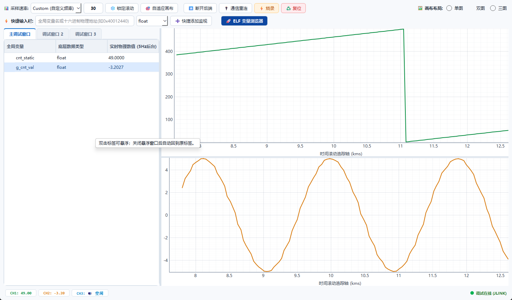

# MCU Live Watch Studio

MCU Live Watch Studio 是面向 Cortex-M 单片机的实时变量观测与波形调试工具。它通过 SEGGER J-Link DLL 或 OpenOCD 直接读写 MCU 内存，不依赖 Keil/Ozone 的断点调试会话，适合电机控制、电源、传感器和 PID 调参等需要固件持续运行的场景。



## 功能

- 从 ELF 符号表和 DWARF 读取全局变量、文件内 `static` 全局变量、结构体、数组和枚举。
- 固定三个调试窗口；双击标签可弹出独立悬浮窗口，关闭后自动回到原标签。
- 表格低速监视和标量写入；三通道高速曲线支持单图、双图和三图布局。
- 自定义采样率、锁定滚动、自适应画布、断开后端、通信重连和手动复位。
- J-Link 原生后端支持 ELF 烧录；普通连接、采样和重连不会主动执行烧录或复位。
- OpenOCD 支持 ST-Link、DAPLink/CMSIS-DAP、J-Link adapter，以及自选 interface/target cfg。
- 常用 STM32 F1/F2/F3/F4/H7 target 可直接选择，其他 MCU 可使用厂商提供的 cfg。
- ELF 更新后自动重新提取符号并刷新已保存变量地址。
- 配置、窗口布局和监视变量保存到程序同级的 `live_watch_history.db`。

## 支持方式

| 后端 | 推荐探针 | 主要用途 | 说明 |
| --- | --- | --- | --- |
| J-Link 原生 | SEGGER J-Link | 变量读写、波形、复位、ELF 烧录 | 使用 SEGGER DLL 和原始设备名，Windows 下优先推荐 |
| OpenOCD | ST-Link | 变量读写、波形、复位 | 选择正确的 interface 和 target cfg |
| OpenOCD | DAPLink/CMSIS-DAP | 变量读写、波形、复位 | 选择 CMSIS-DAP interface 和芯片 target cfg |
| OpenOCD | J-Link | 变量读写、波形、复位 | Windows 下需要 libusb 驱动，与 SEGGER 官方驱动通常不兼容 |

## 快速开始

### 1. 从源码运行

需要 Python 3.10 或更高版本。

```powershell
python -m pip install PyQt6 pyqtgraph numpy pyelftools pylink-square
python .\main.py
```

也可以直接运行 `dist/Mcu_Studio.exe`。首次启动时若同级目录没有数据库，程序会自动创建 `live_watch_history.db`。

### 2. 连接目标板

1. 选择包含调试信息的 `.elf` 文件，建议固件编译时保留 DWARF 信息。
2. 选择硬件后端。
3. J-Link 模式：选择 SEGGER 安装目录，并在芯片选择器中使用准确的原始设备名。
4. OpenOCD 模式：选择 `openocd.exe`、调试器 interface cfg 和与芯片匹配的 target cfg。
5. 点击“初始化硬件并进入工作站”。

仓库自带 OpenOCD，默认路径为 `runtime/OpenOCD/bin/openocd.exe`。常用下拉框只显示程序确认存在的配置；列表中没有的探针或芯片，点击右侧浏览按钮选择任意厂商 `.cfg` 即可。程序会把自选 cfg 所在目录加入 OpenOCD 搜索路径，使其可以继续引用同目录脚本。

### 3. 添加和观察变量

- 已知变量名或物理地址时，可在顶部“快捷输入栏”输入后点击“快速添加监视”。
- 不确定名称时，打开“ELF 变量浏览器”搜索。双击变量会添加到主界面当前选中的调试窗口；右键可明确添加到主调试窗口、调试窗口 2 或调试窗口 3。大型 ELF 单次最多渲染 2000 行，可继续输入关键字缩小范围。
- 文件内 `static` 全局变量只要保留在 ELF/DWARF 中也能读取；同名变量会使用可区分的内部名称。
- 在变量表中右键标量，可绑定到 CH1、CH2 或 CH3；顶部选择单图、双图或三图布局。
- 双击可编辑的标量值可写回 MCU。写入会立即改变目标内存，请先确认变量类型和设备安全状态。
- 双击“主调试窗口 / 调试窗口 2 / 调试窗口 3”标签后，该标签会从主窗口移除，完整变量页进入独立悬浮窗口；关闭悬浮窗口会按原顺序恢复标签。

### 4. 波形与运行控制

- 采样速率支持预设值和自定义值；显示的 kHz 是目标采样率，实际速率取决于探针、SWD 时钟、变量数量和地址连续性。
- “锁定滚动”用于冻结当前时间窗，“自适应画布”重新匹配当前数据范围。
- 空格键可暂停或恢复时间轴，十字光标用于回看时间戳和数值。
- “断开后端”释放硬件连接，“通信重连”重新建立当前后端。
- “复位”会影响目标芯片运行；“烧录”仅在 J-Link 原生模式可用，并会擦写 Flash 后复位运行，操作前均应确认设备安全。

## OpenOCD 与 J-Link 注意事项

- J-Link 原生后端和 OpenOCD J-Link adapter 不是同一套驱动链路。前者使用 SEGGER 官方 DLL，后者使用 libusb。
- Windows 下出现 `LIBUSB_ERROR_NOT_SUPPORTED` / `No J-Link device found` 时，应切换到“J-Link 原生内核驱动”，或改用 ST-Link/DAPLink。不要为此随意用 Zadig 替换 J-Link 官方驱动。
- cfg 存在不等于芯片配置正确。PY32/N32 等型号应使用厂商提供且与芯片完全匹配的 target cfg，不要用 STM32 cfg 猜测替代。
- OpenOCD 加载 target cfg 时可能初始化或复位目标。电机和功率设备请先断开执行机构，在低风险板卡上验证。
- 应用只在本机回环地址启用 TCL 6666，并在连接后验证 OpenOCD 身份；端口被占用时会拒绝连接旧实例。

## 大工程与长期运行

- 变量浏览器搜索有防抖和显示上限，避免大型 ELF 阻塞界面。
- 低速监视只轮询当前页中已展开且实际可见的标量。
- OpenOCD 连续字节读取会合并，高速数据按时间批量发送到界面。
- 每通道历史缓存有上限，避免运行时间增长导致内存无限增加。

## 全项目校验

以下命令不连接探针，也不会读写 MCU：

```powershell
python .\tools\validate_project.py
```

它检查 Python 编译与导入、ELF 表达式、TCL 分包和大小限制、OpenOCD cfg 发现/参数/读取解码、J-Link DLL 位数与原始设备名、Qt 单绑定以及 Git 空白错误。

## 打包

打开 `build.py`，修改顶部 `APP_NAME`（不要带 `.exe`），然后运行：

```powershell
python -m pip install pyinstaller
python .\build.py
```

成品固定输出到项目根目录的 `dist/`，例如 `dist/Mcu_Studio.exe`；中间文件位于 `artifacts/build/`。打包脚本强制使用 PyQt6，并排除 PySide6、PyQt5 等第二套 Qt，构建完成后还会检查 EXE，发现多套 Qt 时直接失败。不要使用 `doc/archive/packaging/` 中的历史 spec。

发布时可只分发 EXE；程序会在 EXE 同级创建数据库。若需要携带已有配置，则把 `live_watch_history.db` 与 EXE 放在同一目录。

## 项目结构

```text
McuStdio/
├─ main.py                  # 唯一应用入口
├─ build.py                 # 打包入口，可修改 APP_NAME
├─ live_watch_history.db   # 本机运行配置，与入口/EXE 同级
├─ mcu_studio/             # 核心、后台硬件任务和界面
├─ assets/                 # 图标和文档截图
├─ runtime/                # 随仓库发布的 OpenOCD、附加 cfg、SVD
├─ packaging/              # 当前 PyInstaller 配置
├─ tools/                  # 校验与辅助工具
├─ doc/                    # 文档、已知问题和历史归档
├─ dist/                   # 打包成品（Git 忽略）
└─ artifacts/              # 可重新生成的构建缓存
```

更多资料见 [文档目录](doc/README.md)、[项目目录说明](doc/01-项目目录.md)、[已知问题与解决状态](doc/02-已知问题.md)、[第三方工具链](doc/03-第三方工具链.md) 和 [后续优化方向](doc/04-后续优化方向.md)。

## 内置工具链与许可

`runtime/` 跟随开源仓库提交，当前包含 OpenOCD 0.12.0、附加 cfg 和 SVD 资源。ELF/DWARF 由 `pyelftools` 直接解析，项目不需要 ARM GCC、GDB、NM、objdump 或 readelf，因此不再携带体积庞大的交叉编译工具链。第三方组件保留各自许可证；发布前请阅读 `doc/03-第三方工具链.md`。
